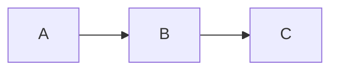
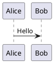

**English** | [中文](README_zh.md)

# Flutter Notes

A Flutter-based Markdown note-taking application with local encrypted storage, GitHub cloud sync, knowledge graph, and rich rendering support.

## Features

### Note Management
- **Markdown Editor** — WYSIWYG-style editing with live preview
- **Auto-Save** — Notes are automatically saved to the local database after 1.5s of inactivity
- **Batch Operations** — Multi-select for batch delete and export
- **Sorting** — By modification time, creation time, or title
- **Tags** — Create, rename, delete, and filter notes by tags with auto-assigned colors
- **Trash** — Soft delete with restore and permanent delete options

### Advanced Rendering
- **Mermaid Diagrams** — Flowcharts, sequence diagrams, Gantt charts
- **LaTeX Math** — Inline `$E=mc^2$` and block `$$...$$` formulas
- **PlantUML** — UML diagrams rendered via PlantUML server
- **Code Highlighting** — Syntax highlighting for 100+ languages
- **Wiki Links** — `[[Note Title]]` creates bidirectional links between notes
- **Outline Panel** — Heading tree navigation
- **Backlinks Panel** — Shows all notes referencing the current note

### Knowledge Graph
- **Visual Network** — Nodes represent notes, edges represent wiki links
- **Interactive** — Tap a node to jump to the note
- **Search** — Filter graph nodes by keyword

### Search
- **FTS5 Full-Text Search** — Fast SQLite full-text search
- **Keyword Highlighting** — Matched terms are highlighted in results
- **Instant Jump** — Tap a result to open the note at the matched position

### Attachments (Week 9)
- **File/Image Picker** — Attach images and files to notes
- **SHA-256 Dedup** — Identical files are stored only once
- **Thumbnail Preview** — Auto-generated image thumbnails
- **Full-screen Viewer** — Pinch-to-zoom image viewing via `photo_view`

### Cloud Sync
- **GitHub OAuth** — Secure login via GitHub OAuth 2.0
- **Bi-directional Sync** — Push notes to / pull notes from GitHub
- **Incremental Sync** — Only changed notes are synced (checkpoints)
- **Conflict Detection** — SHA-based content comparison with resolution UI
- **Markdown Format** — Notes are stored as `.md` files with YAML front matter

### Appearance
- **Material 3 Themes** — Light, Dark, and AMOLED pure black modes
- **System Follow** — Auto-switch based on system theme
- **Seed Color** — Customize the primary color palette
- **i18n** — Chinese / English language switching
- **Animations** — Hero transitions, page animations, and staggered list animations

## Tech Stack

| Category | Technology |
|---|---|
| Framework | Flutter 3.44 / Dart 3.12 |
| State Management | Riverpod 2.x + riverpod_generator |
| Local Database | sqflite + drift ORM |
| Full-Text Search | SQLite FTS5 |
| Markdown Rendering | flutter_markdown + markdown |
| Diagrams | fl_chart, PlantUML server, flutter_math_fork |
| Encryption | AES-256 (encrypt + crypto) |
| Cloud Sync | GitHub REST API + OAuth 2.0 |
| Navigation | go_router |
| Attachments | file_picker 11.0.3 + photo_view |
| Android Target | API 36 (Android 16.0) |

## Project Structure

```
lib/
├── core/
│   ├── config/          # GitHub OAuth config
│   ├── router/         # go_router route definitions
│   ├── theme/          # Material 3 themes (light/dark/AMOLED)
│   └── utils/          # Utilities
├── data/
│   ├── database/       # Drift database definitions
│   ├── models/         # Note, Tag, Attachment, SyncCheckpoint models
│   └── repositories/   # Note, Tag, Attachment repositories
├── features/
│   ├── editor/         # Markdown editor + preview + outline + backlinks
│   ├── graph/          # Knowledge graph visualization
│   ├── notes/          # Note list, batch ops, sorting, tags
│   ├── search/         # FTS5 full-text search
│   ├── settings/       # Theme, language, developer options
│   ├── sync/           # GitHub login, sync settings, conflict resolution
│   └── trash/          # Soft-delete trash bin
├── services/           # Crypto, GitHub, Sync, Preferences, Export services
├── shared/             # Shared widgets
├── app.dart            # MaterialApp + theme config
└── main.dart           # Entry point
```

## Installation

### Prerequisites
- Flutter SDK 3.44+ (Dart 3.12+)
- Android Studio (with Android SDK API 36)
- Visual Studio 2022 Build Tools (for Windows builds)
- Git

### From Source
```bash
git clone https://github.com/Weixianyun/flutter_notes.git
cd flutter_notes
flutter pub get
dart run build_runner build --delete-conflicting-outputs
flutter run
```

### Pre-built Binaries
- **Android APK**: Download `app-release.apk` and install on Android 5.0+ devices
- **Windows**: Download `flutter_notes_windows.zip`, extract, and run `flutter_notes.exe`

## Usage Tutorial

### 1. Create a Note
1. Open the app — you'll see the notes list
2. Tap the floating action button (**+**) at the bottom right
3. A blank editor opens — start typing Markdown

### 2. Edit Markdown
- Type Markdown syntax directly: `# Heading`, `**bold**`, `- list`, `` `code` ``
- The preview renders in real-time
- Use the outline panel (right side) to jump between headings
- Use the backlinks panel to see notes linking to the current note

### 3. Wiki Links
- Type `[[Note Title]]` to create a bidirectional link
- Tap the link to jump to the referenced note
- The linked note's backlinks panel will show the source

### 4. Diagrams
Insert code blocks with the appropriate language:

```
Mermaid flowchart:


LaTeX formula:
$$\frac{n!}{k!(n-k)!} = \binom{n}{k}$$

PlantUML:

```

### 5. Attachments
1. In the editor, tap the attachment button
2. Select an image or file from your device
3. The file is inserted as `attachment://filename`
4. Images show thumbnails; tap to view full-screen with pinch-to-zoom

### 6. Search
1. Tap the search icon in the bottom navigation
2. Type a keyword — results appear instantly with highlighted matches
3. Tap a result to open the note

### 7. Knowledge Graph
1. Tap the graph icon in the bottom navigation
2. Nodes represent notes; edges represent `[[wiki links]]`
3. Tap a node to open the note
4. Use the search bar to filter nodes

### 8. Tags
1. Long-press a note → select tag icon
2. Or go to Settings → Tags to manage tags
3. Tags get auto-assigned colors
4. Filter notes by tapping a tag chip on the home screen

### 9. Trash
1. Long-press a note → Delete (moves to trash)
2. Go to Trash page to restore or permanently delete

### 10. Theme & Language
1. Go to Settings
2. Theme: Light / Dark / AMOLED Black / Follow System
3. Seed Color: Pick a primary color
4. Language: Chinese / English

### 11. GitHub Sync
1. Go to Settings → GitHub Sync
2. Tap **Login to GitHub** — authorize in the WebView
3. Enter your repository owner and name (e.g., `Weixianyun` / `my_notes`)
4. Tap **Save Config**
5. Tap **Sync Now** — all notes are pushed as `.md` files to `notes/` directory
6. Tap **Import Notes** — pull notes from GitHub to local
7. Tap **Detect Conflicts** — if both local and remote changed, resolve by choosing local/remote/skip

### 12. Batch Operations
1. Long-press any note to enter multi-select mode
2. Select multiple notes
3. Use the bottom bar to batch delete or export

## Build

```bash
# Android APK
flutter build apk --release

# Windows EXE
flutter build windows --release

# Code generation (after model/provider changes)
dart run build_runner build --delete-conflicting-outputs
```

## Testing

```bash
flutter test
# 464 tests across unit, widget, and integration tests
```

## Documentation

- [Development Log](docs/dev-log.md)

## License

Personal project. Not licensed for distribution.
