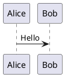

[English](README.md) | **中文**

# Flutter Notes

基于 Flutter 的 Markdown 笔记应用，支持本地加密存储、GitHub 云同步、知识图谱和富文本渲染。

## 功能特性

### 笔记管理
- **Markdown 编辑器** — 所见即所得编辑，实时预览
- **自动保存** — 停止输入 1.5 秒后自动保存到本地数据库
- **批量操作** — 多选删除、批量导出
- **排序** — 按修改时间、创建时间或标题排序
- **标签** — 创建、重命名、删除标签，自动分配颜色，按标签筛选笔记
- **回收站** — 软删除，支持恢复和永久删除

### 高级渲染
- **Mermaid 图表** — 流程图、时序图、甘特图
- **LaTeX 数学公式** — 行内 `$E=mc^2$` 和块级 `$$...$$` 公式
- **PlantUML** — 通过 PlantUML 服务器渲染 UML 图
- **代码高亮** — 支持 100+ 编程语言语法高亮
- **Wiki 双向链接** — `[[笔记标题]]` 创建笔记间双向链接
- **大纲面板** — 标题层级树导航
- **反向链接面板** — 显示所有引用当前笔记的笔记

### 知识图谱
- **可视化网络** — 节点表示笔记，边表示 wiki 链接
- **交互操作** — 点击节点跳转到对应笔记
- **搜索过滤** — 关键词过滤图谱节点

### 搜索
- **FTS5 全文搜索** — 基于 SQLite FTS5 的快速全文检索
- **关键词高亮** — 搜索结果中匹配词高亮显示
- **即时跳转** — 点击结果直接打开笔记并定位关键词位置

### 附件管理
- **文件/图片选择器** — 在笔记中添加图片和文件附件
- **SHA-256 去重** — 相同文件只存储一份，节省空间
- **缩略图预览** — 图片自动生成缩略图
- **全屏查看器** — 支持双指缩放查看图片

### 云同步
- **GitHub OAuth** — 通过 GitHub OAuth 2.0 安全登录
- **双向同步** — 推送本地笔记到 GitHub / 从 GitHub 拉取笔记
- **增量同步** — 仅同步变更的笔记（支持断点续传）
- **冲突检测** — 基于 SHA 的内容比对，提供冲突解决界面
- **Markdown 格式** — 笔记以 `.md` 文件存储，包含 YAML front matter

### 外观
- **Material 3 主题** — 浅色、深色、AMOLED 纯黑三种模式
- **跟随系统** — 根据系统主题自动切换
- **种子色** — 自定义主色调
- **国际化** — 中文 / 英文切换
- **动画** — Hero 过渡动画、页面切换动画、列表交错动画

## 技术栈

| 分类 | 技术 |
|---|---|
| 框架 | Flutter 3.44 / Dart 3.12 |
| 状态管理 | Riverpod 2.x + riverpod_generator |
| 本地数据库 | sqflite + drift ORM |
| 全文搜索 | SQLite FTS5 |
| Markdown 渲染 | flutter_markdown + markdown |
| 图表 | fl_chart, PlantUML 服务器, flutter_math_fork |
| 加密 | AES-256 (encrypt + crypto) |
| 云同步 | GitHub REST API + OAuth 2.0 |
| 导航 | go_router |
| 附件 | file_picker 11.0.3 + photo_view |
| Android 目标 | API 36 (Android 16.0) |

## 项目结构

```
lib/
├── core/
│   ├── config/          # GitHub OAuth 配置
│   ├── router/          # go_router 路由定义
│   ├── theme/           # Material 3 主题（浅色/深色/AMOLED）
│   └── utils/           # 工具类
├── data/
│   ├── database/        # Drift 数据库定义
│   ├── models/          # Note, Tag, Attachment, SyncCheckpoint 模型
│   └── repositories/    # 笔记、标签、附件仓库
├── features/
│   ├── editor/          # Markdown 编辑器 + 预览 + 大纲 + 反向链接
│   ├── graph/           # 知识图谱可视化
│   ├── notes/           # 笔记列表、批量操作、排序、标签
│   ├── search/          # FTS5 全文搜索
│   ├── settings/        # 主题、语言、开发者选项
│   ├── sync/            # GitHub 登录、同步设置、冲突解决
│   └── trash/           # 回收站
├── services/            # 加密、GitHub、同步、偏好设置、导出服务
├── shared/              # 共享组件
├── app.dart             # MaterialApp + 主题配置
└── main.dart            # 入口文件
```

## 安装

### 环境要求
- Flutter SDK 3.44+（Dart 3.12+）
- Android Studio（含 Android SDK API 36）
- Visual Studio 2022 Build Tools（用于 Windows 构建）
- Git

### 从源码构建
```bash
git clone https://github.com/Weixianyun/flutter_notes.git
cd flutter_notes
flutter pub get
dart run build_runner build --delete-conflicting-outputs
flutter run
```

### 预编译包
- **Android APK**：下载 `app-release.apk`，安装到 Android 5.0+ 设备
- **Windows**：下载 `flutter_notes_windows.zip`，解压后运行 `flutter_notes.exe`

## 使用教程

### 1. 新建笔记
1. 打开应用 — 看到笔记列表
2. 点击右下角浮动按钮 (**+**)
3. 进入空白编辑器 — 开始输入 Markdown

### 2. 编辑 Markdown
- 直接输入 Markdown 语法：`# 标题`、`**粗体**`、`- 列表`、`` `代码` ``
- 实时预览自动渲染
- 使用右侧大纲面板在标题间跳转
- 使用反向链接面板查看引用当前笔记的其他笔记

### 3. Wiki 双向链接
- 输入 `[[笔记标题]]` 创建双向链接
- 点击链接跳转到引用的笔记
- 被引用笔记的反向链接面板会显示来源

### 4. 图表渲染
使用对应语言的代码块插入图表：

```
Mermaid 流程图：


LaTeX 公式：
$$\frac{n!}{k!(n-k)!} = \binom{n}{k}$$

PlantUML：

```

### 5. 附件管理
1. 在编辑器中点击附件按钮
2. 从设备选择图片或文件
3. 文件以 `attachment://文件名` 格式插入
4. 图片显示缩略图，点击可全屏双指缩放查看

### 6. 搜索
1. 点击底部导航栏的搜索图标
2. 输入关键词 — 结果即时显示并高亮匹配词
3. 点击结果打开笔记

### 7. 知识图谱
1. 点击底部导航栏的图谱图标
2. 节点表示笔记，边表示 `[[wiki 链接]]`
3. 点击节点打开对应笔记
4. 使用搜索栏过滤节点

### 8. 标签
1. 长按笔记 → 选择标签图标
2. 或前往设置 → 标签管理
3. 标签自动分配颜色
4. 首页点击标签 Chip 筛选笔记

### 9. 回收站
1. 长按笔记 → 删除（移入回收站）
2. 前往回收站页面恢复或永久删除

### 10. 主题与语言
1. 进入设置
2. 主题：浅色 / 深色 / AMOLED 纯黑 / 跟随系统
3. 种子色：选择主色调
4. 语言：中文 / English

### 11. GitHub 同步
1. 进入设置 → GitHub 同步
2. 点击**登录 GitHub** — 在 WebView 中授权
3. 填写仓库所有者和名称（如 `Weixianyun` / `my_notes`）
4. 点击**保存配置**
5. 点击**立即同步** — 所有笔记以 `.md` 文件推送到仓库 `notes/` 目录
6. 点击**导入笔记** — 从 GitHub 拉取笔记到本地
7. 点击**检测冲突** — 如果本地和远端都修改了，选择保留本地/远端/跳过

### 12. 批量操作
1. 长按任意笔记进入多选模式
2. 选择多个笔记
3. 使用底部操作栏批量删除或导出

## 构建

```bash
# Android APK
flutter build apk --release

# Windows EXE
flutter build windows --release

# 代码生成（修改 model/provider 后执行）
dart run build_runner build --delete-conflicting-outputs
```

## 测试

```bash
flutter test
# 464 个测试（单元测试、组件测试、集成测试）
```

## 文档

- [开发日志](docs/dev-log.md)

## 许可证

个人项目，未授权分发。
